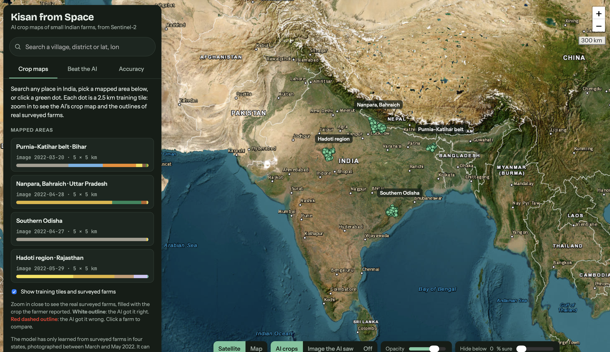

# 🛰️ Kisan from Space

**AI crop-type mapping of Indian smallholder farms from free Sentinel-2 satellite imagery**

[](https://khushi-patel15.github.io/kisan-from-space/)


> B.Tech Project (Phase I) · School of Technology Management & Engineering (STME), NMIMS Indore · 2026–27



---

## The problem

India has about **146 million farm holdings**, and most are smaller than a football field. Crop insurance (PMFBY), food-supply planning and drought relief all need to know **which crop is growing in which field**. Today that information mostly comes from manual field surveys, which are slow, costly and often late.

The European **Sentinel-2** satellite photographs every farm in India every 5 days in 12 spectral bands, free of charge. This project asks:

> **Can AI name the crop in each small Indian field from free satellite images, and how small is too small?**

## What it does

1. **Learns** what each crop looks like from space, using 5,551 ground-surveyed fields.
2. **Predicts** a crop map for every pixel and every field.
3. **Generalises** to new land by converting fresh Sentinel-2 scenes into the training data's exact format.
4. **Publishes** everything on an interactive map website that anyone can explore.

## Live website

**👉 [khushi-patel15.github.io/kisan-from-space](https://khushi-patel15.github.io/kisan-from-space/)**

- Zoomable satellite basemap with Google-Maps-style place search
- AI crop-map overlays on **1,165 tiles** plus **4 newly mapped 5 × 5 km areas**
- **5,953 real surveyed farms**: white outline = AI correct, red dashed = AI wrong
- "Image the AI saw" toggle and confidence filter
- **Beat the AI** game and an honest **Accuracy** tab

## Dataset

[**AgriFieldNet India**](https://source.coop/repositories/radiantearth/agrifieldnet-competition) (Radiant Earth Foundation & IDinsight, CC BY 4.0)

| | |
|---|---|
| Surveyed fields | 5,551 |
| Classes | 13 (12 crops + fallow) |
| States | Uttar Pradesh, Bihar, Odisha, Rajasthan |
| Image tiles | 1,165 × (256 × 256 px, 12 bands, 10 m resolution) |
| Median field size | 0.23 ha (≈ 23 pixels) |

The data is heavily imbalanced: wheat, fallow and mustard make up 84% of fields.

## Method

**Fair evaluation.** Fields are split by **0.1° spatial blocks** (StratifiedGroupKFold) into train / validation / test (3,231 / 1,260 / 1,060 fields), so models are always scored on regions they have never seen.

**Models**

| Model | Description |
|---|---|
| **Random Forest** (baseline) | 31 field-level features: mean and std of 12 bands plus NDVI, NDWI and NDRE, and field area. 500 trees, balanced class weights |
| **U-Net** | ResNet-34 encoder (ImageNet init), 12-channel input, ~24 M parameters. Masked, class-weighted cross-entropy, AdamW + OneCycle, 60 epochs on a Kaggle T4 GPU. Field prediction = mean of pixel probabilities, with flip test-time augmentation |
| **Ensemble** | Average of Random Forest and U-Net probabilities |

**New-area mapping.** For each region the original Sentinel-2 L2A scene was identified via the Element84 Earth Search STAC API, its 8-bit conversion was reproduced from nearby tiles, and non-cropland was masked using ESA WorldCover 2021.

## Results (test set: 1,060 unseen fields)

| Model | Accuracy | Macro F1 |
|---|---|---|
| Always "wheat" baseline | 36.5% | 0.041 |
| **Random Forest** | **53.4%** | 0.196 |
| U-Net | 41.1% | **0.198** |
| Ensemble | 49.8% | 0.188 |

The U-Net had the best **validation** macro F1 (0.253) and is the only model that detects any rare crop (gram, potato, lentil).

**Key findings**

- 📏 **Field size limits accuracy.** U-Net balanced accuracy rises from **0.22** on fields under 0.1 ha to **0.66** on fields over 1 ha.
- 📅 **Image timing matters.** Each state was imaged on a single date between 20 March and 29 May 2022, mostly at or after harvest. This explains the weak mustard results and introduces a region–date bias.
- 🌍 **Generalisation works.** Predictions on converted versus original images agree for **88–97%** of fields.

## Tech stack

`Python` · `PyTorch` · `segmentation-models-pytorch` · `scikit-learn` · `rasterio` · `NumPy / pandas` · `STAC (Earth Search)` · `ESA WorldCover` · `Leaflet.js` · `JavaScript` · `GitHub Pages` · `Kaggle GPU`

## Repository structure

```
kisan-from-space/
├── data/              # frozen train/val/test split (raw dataset not included)
├── docs/              # the website served by GitHub Pages
├── kisan/             # shared helper code
├── scripts/           # numbered pipeline steps
├── requirements.txt
└── README.md
```

> The raw dataset and trained weights are not committed (size and licence). Download AgriFieldNet from the link above.

## Run the website locally

```bash
git clone https://github.com/khushi-patel15/kisan-from-space.git
cd kisan-from-space
python -m http.server 8000 --directory docs
# open http://localhost:8000
```

The crop maps work offline. The satellite basemap and place search need an internet connection.

## Limitations

- One late-season image per region, so there is no information on how crops grow through the season
- Very few labels for rare crops (four classes have fewer than 10 test fields)
- Predictions are valid only near the training regions and for 2022
- Results come from a single training run

## Roadmap (Phase II)

- [ ] Full-season Sentinel-2 time series (November to April)
- [ ] Sentinel-1 radar, which sees through cloud
- [ ] Cross-state evaluation to measure and reduce regional bias
- [ ] Better rare-crop handling and foundation models
- [ ] Research paper: *"How small is too small?"*

## Acknowledgements

- AgriFieldNet India dataset: Radiant Earth Foundation & IDinsight (CC BY 4.0)
- Copernicus Sentinel-2 data: European Space Agency
- ESA WorldCover 2021
- Basemaps: Esri World Imagery, © OpenStreetMap contributors; geocoding by Photon (Komoot)
- Project Mentor : Dr.Raj Gaurav Mishra, STME, NMIMS Indore

## Author

**Khushi Patel**, B.Tech, STME, NMIMS Indore
